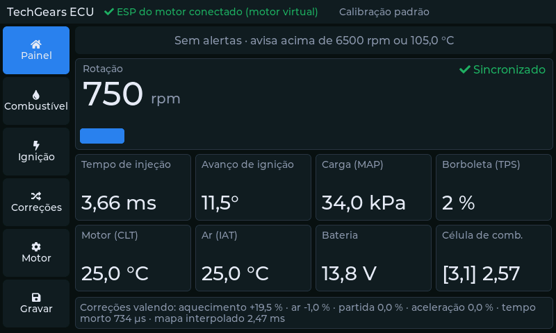
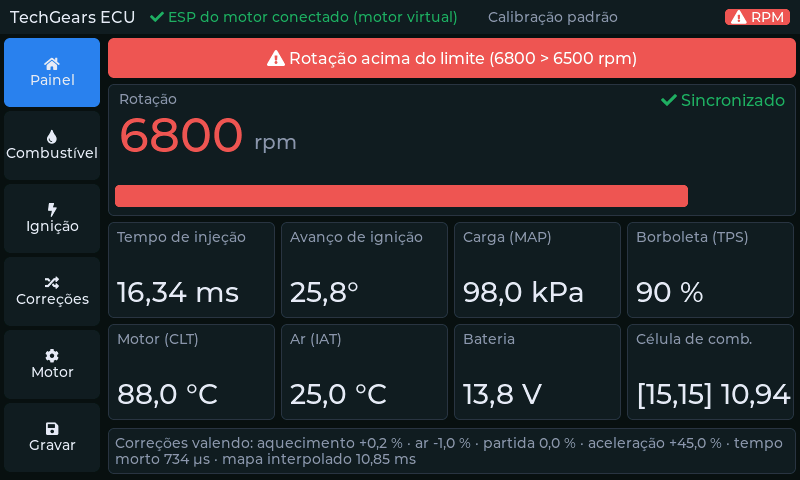
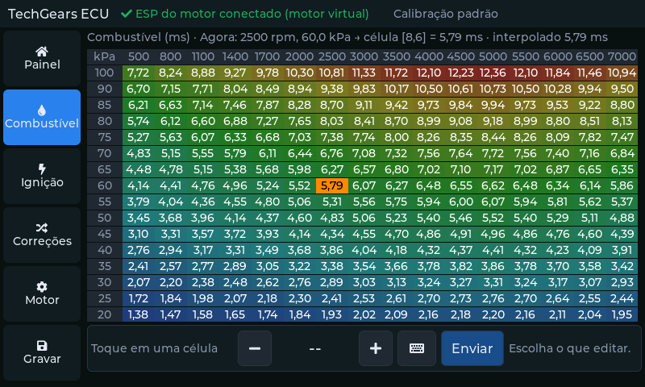
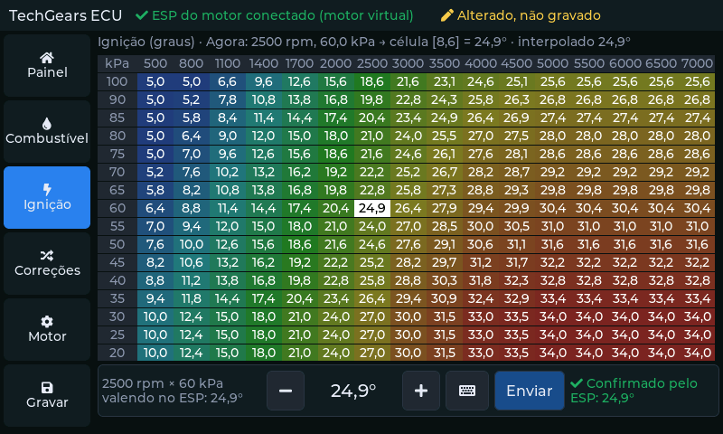
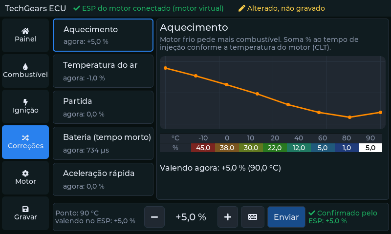
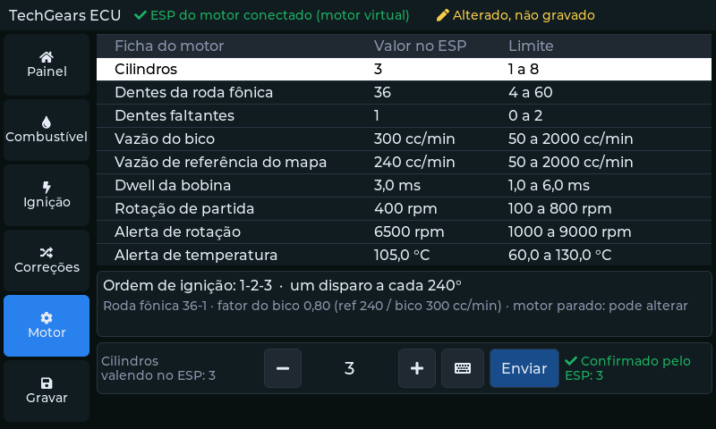
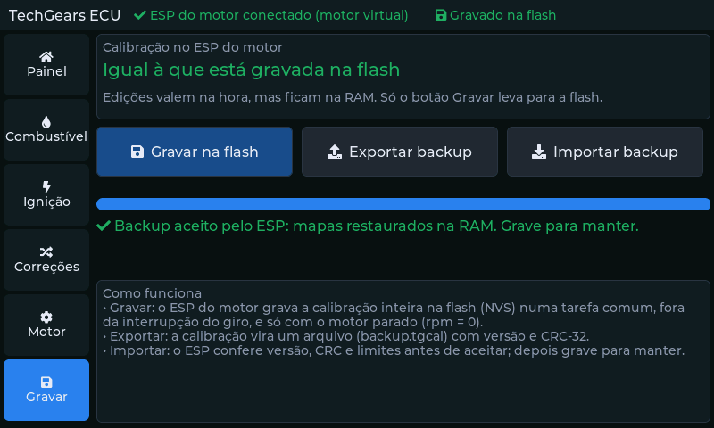

<div style={{textAlign: 'justify'}}>

# HMI na ESP32-S3: painel, alertas e calibração

Projeto: Programmable ECU - TechGears Inteli  
Features: 1.7 Painel e datalog (#150) e 1.6 Calibração dos mapas (#143)  
Tasks: 1.7.1.1 (#187), 1.7.1.2 (#152), 1.7.1.3 (#153), 1.6.1.2 a 1.6.1.8 (#146 a #149, #184 a #186)  
Código: `src/firmware/hmi/` (telas e firmware da S3) e `src/software/hmi-sim/` (simulador)

## O que é

&emsp;A HMI (interface homem-máquina) é a tela de 4,3" (800×480, touch capacitivo) ligada a uma ESP32-S3, separada do ESP do motor. Ela segue o modelo da FuelTech: **o cérebro fica no ESP do motor e a tela só mostra e pede**. A tela não calcula o tempo de injeção e não grava a calibração. Ela lê números pela UART ([Protocolo UART](/protocolo-uart)) e envia pedidos que o motor confirma ou recusa.

&emsp;As telas foram feitas com o **LVGL 9.2.2**, uma biblioteca gráfica em C feita para microcontroladores. O código das telas (`src/firmware/hmi/ui`) é **o mesmo** no simulador do PC e na placa. Muda só o driver da placa: tela, touch, UART e arquivo.

<div align="center">

<small><strong>Quadro 1 - Telas e tasks</strong></small>

| Tela | O que mostra / faz | Tasks |
|---|---|---|
| Painel | RPM, PW, avanço, carga, TPS, CLT, IAT, bateria, célula atual, correções valendo | 1.7.1.1, 1.7.1.2 |
| Alertas | Faixa vermelha e aviso na barra de cima quando RPM ou CLT passam do limite | 1.7.1.3 |
| Combustível | Grade 16×16 com cores, célula atual em laranja, edição com confirmação | 1.6.1.2, 1.6.1.3, 1.6.1.4 |
| Ignição | Mesma grade para o avanço (limite -10 a 45°) | 1.6.1.5 |
| Correções | 5 curvas 2D com gráfico, valor valendo agora e edição | 1.6.1.6 |
| Motor | Ficha do motor e ordem de ignição | 1.6.1.7 |
| Gravar | Gravar na flash, exportar e importar backup | 1.6.1.8 |

Fonte: elaborado pelos autores.

</div>

## Painel e alertas

<div align="center">



<small><strong>Figura 1 - Painel com o motor virtual em marcha lenta (750 rpm, 25 °C)</strong></small>

Fonte: captura do simulador (`hmi_sim --headless`), elaborada pelos autores.

</div>

&emsp;O painel atualiza a 10 Hz com a telemetria que o motor manda a 20 Hz. Como a S3 é outra placa, desenhar a tela não atrasa o cálculo do motor (critério da 1.7.1.2).

&emsp;**Regra dos alertas (1.7.1.3).** Os limites moram na ficha do motor, dentro do ESP do motor: "Alerta de rotação", padrão 6500 rpm, e "Alerta de temperatura", padrão 105,0 °C. Assim eles são gravados e copiados no backup junto com o resto. A tela compara cada telemetria com esses limites:

- abaixo ou igual ao limite, o alerta fica apagado;
- **acima** do limite, aparece a faixa vermelha no painel e um aviso na barra de cima, que fica visível em todas as telas;
- o alerta **não altera o mapa** sozinho. Cortar injeção por rotação ou temperatura é proteção do motor (feature 1.8), não da tela.

<div align="center">



<small><strong>Figura 2 - Alerta de rotação: 6800 rpm acima do limite de 6500 rpm</strong></small>

Fonte: captura do simulador, elaborada pelos autores.

</div>

## Mapas: célula atual, edição e grades

&emsp;A grade mostra as 16×16 células, com a carga alta no topo, como nos softwares de calibração. As cores vão do azul (pouco combustível) ao vermelho (muito). A célula em que o motor está agora fica em **laranja**. A linha de cima mostra os índices e os valores que o ESP mandou.

<div align="center">



<small><strong>Figura 3 - Grade de combustível com a célula atual [8,6] (60 kPa × 2500 rpm) em laranja</strong></small>

Fonte: captura do simulador, elaborada pelos autores.

</div>

&emsp;**Editar (1.6.1.3).** Toque numa célula (ela fica branca). Ajuste com − e + (passo de 0,05 ms) ou com o teclado numérico e toque em **Enviar**. A tela mostra "Aguardando o ESP do motor…" e depois a resposta do motor:

- **Confirmado pelo ESP**: o valor passou a valer e o PW muda na hora;
- **Recusado pelo ESP: fora do limite. Mantido X**: o mapa anterior continua.

&emsp;Se o número digitado já estiver fora do limite, a tela avisa antes ("o ESP vai recusar"). Mesmo assim, quem decide é o motor.

<div align="center">


<small><strong>Figura 4 - Célula editada para 5,99 ms e confirmada pelo ESP do motor</strong></small>

Fonte: captura do simulador, elaborada pelos autores.

</div>

<div align="center">


<small><strong>Figura 5 - 99,99 ms recusado pelo ESP (limite de 20,00 ms); o valor anterior foi mantido</strong></small>

Fonte: captura do simulador, elaborada pelos autores.

</div>

<div align="center">



<small><strong>Figura 6 - Grade de ignição: a célula editada mudou o avanço calculado</strong></small>

Fonte: captura do simulador, elaborada pelos autores.

</div>

## Correções, ficha do motor e gravação

<div align="center">



<small><strong>Figura 7 - Curva de aquecimento com a correção valendo agora (+5,0 % a 90 °C)</strong></small>

Fonte: captura do simulador, elaborada pelos autores.

</div>

<div align="center">



<small><strong>Figura 8 - Ficha do motor: 3 cilindros aceitos com o motor parado, e a ordem de ignição virou 1-2-3</strong></small>

Fonte: captura do simulador, elaborada pelos autores.

</div>

<div align="center">



<small><strong>Figura 9 - Backup importado e aceito pelo ESP do motor</strong></small>

Fonte: captura do simulador, elaborada pelos autores.

</div>

&emsp;Os detalhes do cálculo, das correções, da ficha e da gravação estão em [Núcleo de cálculo e calibração](/nucleo-calibracao).

## Simulador no PC (1.7.1.1)

&emsp;O desenho da tela passa pelo simulador antes de ir para a S3, para não usar a placa como rascunho. O simulador junta três peças:

- as **mesmas telas** LVGL da S3;
- um **motor virtual**, com o mesmo núcleo do ESP do motor e a "flash" num arquivo;
- um "fio" em memória que leva **os mesmos bytes do protocolo** nos dois sentidos.

&emsp;Sem argumentos, ele abre uma janela 800×480 no Windows e o motor virtual repete um ciclo de 40 s: partida, lenta, aceleração forte, passagem do limite de rotação, desaceleração e cruzeiro, enquanto o motor esquenta. Com `--headless`, ele roda os **cenários de teste sem janela**: toca nos mesmos botões, confere os textos da tela e o que mudou no motor virtual, e grava as capturas usadas nesta página.

```bash
python -m pip install --user cmake ninja ziglang   # uma vez (compilador C sem instalador)
python tools/host_build.py                         # compila e roda os testes (núcleo + telas)
python tools/host_build.py --sim                   # ...e abre a janela do simulador
python tools/host_build.py --capturas docs/docs/img/hmi   # regenera as figuras
python tools/host_build.py --docker                # tudo num container Linux
```

&emsp;Se o Windows bloquear executáveis recém-compilados (Smart App Control ligado), use `--docker`. Ele roda os testes e gera as capturas num container Linux, mas sem a janela interativa.

## Firmware da S3 e ligação

&emsp;O firmware da placa (`src/firmware/hmi/s3`, PlatformIO com Arduino-ESP32 2.0.17) faz quatro coisas:

- liga o painel RGB pelo `esp_lcd`, com o framebuffer na PSRAM;
- lê o touch GT911 por I2C;
- conversa com o motor pela UART1;
- guarda o backup na LittleFS (`/backup.tgcal`).

&emsp;A placa configurada é a Sunton ESP32-8048S043C, porque o modelo definitivo ainda não foi comprado. **Os pinos estão todos em `board.h` e precisam ser conferidos na placa real.**

&emsp;Para testar a tela sem o firmware completo do motor, há um firmware de bancada para um ESP32 DevKit (`src/firmware/motor-bench`). Quatro potenciômetros fazem o papel de RPM, carga, CLT e TPS. Ele imprime no Serial a célula, o valor e o PW, para comparar com a tela, e guarda a calibração na NVS. Ele não aciona bico nem bobina.

<div align="center">

<small><strong>Quadro 2 - O que a S3 recebe e o que nunca recebe</strong></small>

| Liga na S3 | Não liga na S3 |
|---|---|
| TX, RX e GND da UART do ESP do motor (3,3 V) | 12 V da bateria |
| Alimentação 5 V própria (USB ou fonte da tela) | Sinais de sensores (CKP, MAP, TPS, CLT, IAT) |
| | Saídas de bico, bobina ou relé |

Fonte: Contexto das decisões e elaborado pelos autores.

</div>

## O que já foi verificado e o que falta na bancada

<div align="center">

<small><strong>Quadro 3 - Estado da verificação</strong></small>

| Item | Verificado no PC | Falta na bancada |
|---|---|---|
| Protocolo, limites, ficha, gravação e backup | Sim: testes do núcleo e cenários do simulador | Fiação real e erro de linha com cabo |
| Telas e toques | Sim: cenários headless, 54 verificações | Tela e touch reais da S3 (pinos de `board.h`) |
| Firmwares S3 e motor de bancada | Compilam com PlatformIO | Gravar nas placas e comparar o Serial com a tela |
| PW e avanço mudando com a edição | Sim: no motor virtual (mesmo núcleo) | Lâmpada ou osciloscópio com o firmware da 1.5 |
| Gravação na NVS | Sim: arquivo no simulador, mesma lógica | NVS real do ESP32 e reinício com a chave |

Fonte: elaborado pelos autores.

</div>

## Referências

- LVGL. _LVGL Documentation v9.2._ Disponível em: [https://docs.lvgl.io/9.2/](https://docs.lvgl.io/9.2/). Acesso em: 25 nov. 2026.
- LVGL. _Código-fonte do driver Windows (v9.2.2)._ Disponível em: [https://github.com/lvgl/lvgl/tree/v9.2.2/src/drivers/windows](https://github.com/lvgl/lvgl/tree/v9.2.2/src/drivers/windows). Acesso em: 25 nov. 2026.
- ESPRESSIF. _ESP-IDF Programming Guide (v4.4): LCD (RGB interface)._ Disponível em: [https://docs.espressif.com/projects/esp-idf/en/v4.4/esp32s3/api-reference/peripherals/lcd.html](https://docs.espressif.com/projects/esp-idf/en/v4.4/esp32s3/api-reference/peripherals/lcd.html). Acesso em: 25 nov. 2026.
- RZELDENT. _esp32-smartdisplay: board definitions (ESP32-8048S043)._ Disponível em: [https://github.com/rzeldent/esp32-smartdisplay](https://github.com/rzeldent/esp32-smartdisplay). Acesso em: 25 nov. 2026.
- PLATFORMIO. _PlatformIO Documentation._ Disponível em: [https://docs.platformio.org/](https://docs.platformio.org/). Acesso em: 25 nov. 2026.
- ZIG SOFTWARE FOUNDATION. _Zig: zig cc as a drop-in C compiler._ Disponível em: [https://ziglang.org/](https://ziglang.org/). Acesso em: 25 nov. 2026.
- ULANOVSKY, Julieta. _Montserrat font (SIL Open Font License 1.1)._ Disponível em: [https://github.com/JulietaUla/Montserrat](https://github.com/JulietaUla/Montserrat). Acesso em: 25 nov. 2026.
- FUELTECH. _FT450: manual de instalação e operação._ Porto Alegre: FuelTech, s.d.

</div>
