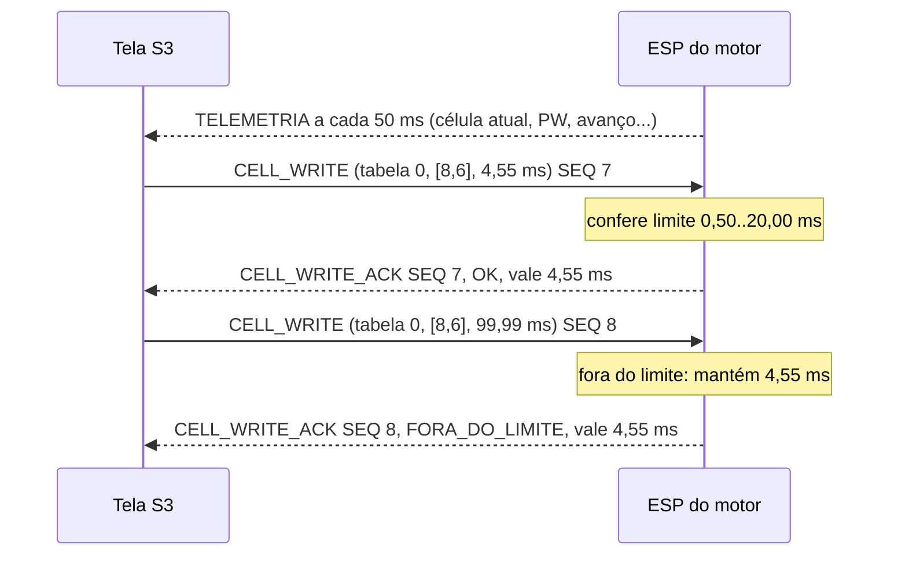

<div style={{textAlign: 'justify'}}>

# Protocolo UART entre o ESP do motor e a tela S3

Projeto: Programmable ECU - TechGears Inteli  
Task: 1.6.1.1 - Definir o protocolo UART de leitura e escrita de células do mapa (#145)  
Código: `src/firmware/common/include/ecu/ecu_protocol.h` e `src/firmware/common/src/ecu_protocol.c`

## Para que serve

&emsp;A ECU tem duas placas, conforme o [Contexto das decisões](/contexto-decisoes). O **ESP do motor** lê os sensores, calcula e comanda. A **ESP32-S3 com tela** é só a interface. Este protocolo é a conversa entre as duas pela UART: o motor manda a telemetria e a tela pede para ler ou mudar números da calibração. Ele substitui o servidor WebSocket do desenho antigo, porque não existe mais site nem Wi-Fi no caminho de calibração.

&emsp;A regra mais importante: **o ESP do motor é a autoridade do valor**. A tela nunca grava nada sozinha. Ela pede, o motor confere o valor contra os limites e responde. Se aceitar, o valor passa a valer na hora. Se recusar, o valor antigo continua e a resposta diz por quê. A tela só mostra o que o motor respondeu.

## Linha física

&emsp;A ligação é a UART em 3,3 V, a 115200 bps, 8 bits, sem paridade e 1 stop bit (8N1). Só três fios passam entre as placas: TX, RX e GND. Nenhum fio de 12 V, sensor, bico ou bobina chega à S3.

<div align="center">

<small><strong>Quadro 1 - Ligação entre as placas</strong></small>

| ESP do motor (ESP32) | Fio | Tela (ESP32-S3) |
|---|---|---|
| GPIO17 (TX da UART2) | dado motor → tela | RX da UART1 (GPIO18, a confirmar na placa) |
| GPIO16 (RX da UART2) | dado tela → motor | TX da UART1 (GPIO17, a confirmar na placa) |
| GND | referência comum | GND |

Fonte: elaborado pelos autores (firmwares `motor-bench` e `hmi/s3`).

</div>

## Formato do frame

&emsp;Toda mensagem vai dentro de um frame com começo marcado, tamanho e verificação de erro. Os números de 16 e 32 bits seguem a ordem little-endian (byte menos significativo primeiro), que é a ordem nativa dos dois ESP32.

```text
+------+-----+-----+------+-------------------+-----------+
| 0xA5 | LEN | SEQ | TYPE | PAYLOAD (LEN bytes) | CRC16 lo hi |
+------+-----+-----+------+-------------------+-----------+
   1      1     1     1         0 a 240              2
```

<div align="center">

<small><strong>Quadro 2 - Campos do frame</strong></small>

| Campo | Tamanho | O que é |
|---|---|---|
| SOF | 1 byte | Sempre `0xA5`. O receptor descarta bytes até achar um. |
| LEN | 1 byte | Tamanho do payload, de 0 a 240. |
| SEQ | 1 byte | Número do pedido. A resposta repete o SEQ do pedido. |
| TYPE | 1 byte | Tipo da mensagem (Quadro 3). |
| PAYLOAD | LEN bytes | Conteúdo da mensagem. |
| CRC16 | 2 bytes | CRC-16/CCITT-FALSE de LEN, SEQ, TYPE e PAYLOAD. |

Fonte: elaborado pelos autores.

</div>

&emsp;O **CRC-16/CCITT-FALSE** (polinômio 0x1021, valor inicial 0xFFFF) detecta qualquer erro de 1 ou 2 bits e qualquer rajada de até 16 bits trocados no caminho. O vetor de teste conhecido, `"123456789"`, dá `0x29B1`, e isso está nos testes. Se o CRC não fecha, o frame é descartado, e o lado que pediu manda de novo.

&emsp;**Ressincronização.** Se chegar lixo, o parser procura o próximo `0xA5`. Um `0xA5` falso seguido de um LEN grande faria o parser esperar até 246 bytes. Por isso, quando a linha fica 5 ms parada (`ECU_IDLE_FLUSH_MS`), o que ficou incompleto é descartado byte a byte, aproveitando qualquer frame bom que estiver no meio. Os dois firmwares chamam essa limpeza.

## Mensagens

&emsp;A regra dos tipos é simples: **resposta = pedido + 0x80**. A telemetria (0x10) não tem resposta, e o NACK (0x7F) avisa que o pedido não foi entendido (tipo desconhecido ou tamanho errado).

<div align="center">

<small><strong>Quadro 3 - Tipos de mensagem</strong></small>

| Pedido (tela → motor) | Resposta (motor → tela) | Para quê |
|---|---|---|
| `0x01` PING | `0x81` PONG | Achar o motor e conferir a versão do protocolo |
| — | `0x10` TELEMETRIA (20 Hz) | Painel ao vivo, célula atual e correções valendo |
| `0x20` TABLE_INFO | `0xA0` | Dimensões, eixos, unidade e limites de uma tabela |
| `0x21` CELL_READ | `0xA1` | Ler uma célula |
| `0x22` ROW_READ | `0xA2` | Ler uma linha inteira (carregar a grade) |
| `0x23` CELL_WRITE | `0xA3` | Escrever uma célula; o motor confirma ou recusa |
| `0x30` PARAM_READ | `0xB0` | Ler um item da ficha do motor |
| `0x31` PARAM_WRITE | `0xB1` | Escrever um item da ficha (só com o motor parado) |
| `0x40` SAVE | `0xC0` | Gravar a calibração da RAM na flash |
| `0x50` BACKUP_READ | `0xD0` | Exportar o backup em blocos de 200 bytes |
| `0x51`, `0x52`, `0x53` RESTORE | `0xD1`, `0xD2`, `0xD3` | Importar um backup: início, blocos e confirmação |

Fonte: elaborado pelos autores (`ecu_msg_type_t` em `ecu_protocol.h`).

</div>

### Leitura e escrita de célula

&emsp;O pedido de leitura leva `tabela, linha, coluna` (3 bytes). O pedido de escrita leva também o valor desejado, `tabela, linha, coluna, valor` (5 bytes). As duas respostas usam o mesmo formato: `tabela, linha, coluna, status, valor` (6 bytes). O **valor da resposta é sempre o que está valendo no motor**: o novo, se foi aceito, ou o anterior, se foi recusado. Assim a tela nunca fica com um número que o motor não tem.

<div align="center">

<small><strong>Quadro 4 - Tabelas e limites que o motor aceita</strong></small>

| Id | Tabela | Tamanho | Unidade do valor | Limite |
|---|---|---|---|---|
| 0 | Combustível | 16 × 16 (MAP × RPM) | ms × 100 | 0,50 a 20,00 ms |
| 1 | Ignição | 16 × 16 (MAP × RPM) | graus × 10 | -10,0 a 45,0° |
| 2 | Aquecimento (por CLT) | 8 pontos | % × 10 | 0 a +200 % |
| 3 | Temperatura do ar (por IAT) | 8 pontos | % × 10 | -30 a +30 % |
| 4 | Partida (por CLT) | 8 pontos | % × 10 | 0 a +400 % |
| 5 | Bateria: tempo morto (por tensão) | 8 pontos | µs | 0 a 3000 µs |
| 6 | Aceleração rápida (por %/s de TPS) | 8 pontos | % × 10 | 0 a +200 % |

Fonte: elaborado pelos autores (`ecu_calib.c`).

</div>

<div align="center">

<small><strong>Quadro 5 - Status das respostas</strong></small>

| Código | Nome | Quando |
|---|---|---|
| 0 | OK | Aceito |
| 1 | FORA_DO_LIMITE | Valor fora do limite: recusado, o anterior continua |
| 2 | INDICE_INVALIDO | Linha, coluna ou offset que não existe |
| 3 | TABELA_INVALIDA | Tabela que não existe |
| 4 | MOTOR_GIRANDO | Ficha, gravação e importação exigem rpm = 0 |
| 5 | ERRO_FLASH | A gravação na flash falhou |
| 6 | BACKUP_INVALIDO | Versão, tamanho, CRC ou limite do backup não fecham |
| 7 | PARAMETRO_INVALIDO | Item da ficha inexistente ou combinação impossível |

Fonte: elaborado pelos autores (`ecu_status_t`).

</div>

### Exemplo: escrita aceita

&emsp;A tela pede para mudar a célula de combustível da linha 8, coluna 6 (60 kPa × 2500 rpm) para 4,55 ms. Na escala ms × 100, isso é 455 = `0x01C7`. O pedido usa SEQ = 7:

```text
Pedido  (tela -> motor): A5 05 07 23 | 00 08 06 C7 01 | CRC lo CRC hi
                          SOF LEN SEQ TYPE  tab lin col valor(455)
Resposta (motor -> tela): A5 06 07 A3 | 00 08 06 00 C7 01 | CRC lo CRC hi
                                         tab lin col OK valor que vale (455)
```

### Exemplo: recusa por limite

&emsp;A mesma célula recebe 99,99 ms (9999 = `0x270F`). O limite é 20,00 ms, então o motor responde FORA_DO_LIMITE (1) e devolve o valor que continua valendo (455):

```text
Pedido  (tela -> motor): A5 05 08 23 | 00 08 06 0F 27 | CRC
Resposta (motor -> tela): A5 06 08 A3 | 00 08 06 01 C7 01 | CRC
                                                   ^ status 1, mantido 455
```



## Telemetria

&emsp;A telemetria tem 44 bytes de payload e sai 20 vezes por segundo (a cada 50 ms). A 115200 bps, isso ocupa menos de 10 % da linha. Ela leva tudo o que o painel e os mapas mostram:

- rotação, carga (MAP), TPS, temperatura do motor (CLT), temperatura do ar (IAT) e bateria;
- tempo de injeção comandado (PW), avanço e dwell;
- célula de combustível e de ignição mais próximas, o valor dessas células e o valor interpolado;
- cada correção valendo agora (aquecimento, ar, partida, aceleração, tempo morto) e o fator do bico;
- bits de estado: sincronizado, em partida, girando, calibração padrão (flash vazia) e "alterado, não gravado".

&emsp;A telemetria não exige que a tela responda. Se a tela travar ou for desligada, o motor continua igual. Esse é o motivo de a tela ser outra placa.

## Pedidos perdidos e repetidos

&emsp;A tela manda **um pedido por vez** e espera a resposta com o mesmo SEQ. Se ela não chega em 200 ms, a tela reenvia o mesmo frame, até 3 vezes. Se o motor recebe de novo um pedido com o mesmo SEQ e tipo do último, ele não aplica outra vez: só repete a resposta guardada. Assim, uma resposta perdida no cabo não faz uma escrita valer duas vezes. Há um teste exatamente para isso (`test_resposta_perdida_e_reenviada_sem_aplicar_duas_vezes`).

## Como foi verificado

- `test_protocol`: CRC com os vetores conhecidos, formato do frame igual ao deste documento, ida e volta de todas as mensagens, parser byte a byte, recusa de CRC errado e ressincronização depois de lixo.
- `test_links`: tela e motor conversando pelo protocolo em memória. Cobre aceitar e recusar escrita, ficha só com o motor parado, gravar, reiniciar, backup e reenvio.
- Cenários do simulador (`hmi_e2e`): os mesmos pedidos feitos pelos botões da tela, contra o motor virtual.

&emsp;Na bancada ainda falta medir com as placas reais: a fiação, o nível de 3,3 V e a taxa de erro com cabo de verdade. Veja [HMI na S3](/hmi-s3).

## Referências

- COOK, Greg. _Catalogue of parametrised CRC algorithms: CRC-16/IBM-3740 (CCITT-FALSE)._ Disponível em: [https://reveng.sourceforge.io/crc-catalogue/16.htm](https://reveng.sourceforge.io/crc-catalogue/16.htm). Acesso em: 25 nov. 2026.
- ESPRESSIF. _ESP32 Technical Reference Manual: UART Controller._ Disponível em: [https://www.espressif.com/sites/default/files/documentation/esp32_technical_reference_manual_en.pdf](https://www.espressif.com/sites/default/files/documentation/esp32_technical_reference_manual_en.pdf). Acesso em: 25 nov. 2026.
- ESPRESSIF. _Arduino-ESP32: Serial (UART)._ Disponível em: [https://docs.espressif.com/projects/arduino-esp32/en/latest/api/serial.html](https://docs.espressif.com/projects/arduino-esp32/en/latest/api/serial.html). Acesso em: 25 nov. 2026.
- FUELTECH. _FT450: manual de instalação e operação._ Porto Alegre: FuelTech, s.d.
- TANENBAUM, Andrew S.; WETHERALL, David J. _Redes de computadores._ 5. ed. São Paulo: Pearson, 2011. (Capítulo 3: enquadramento, detecção de erros e retransmissão.)

</div>
