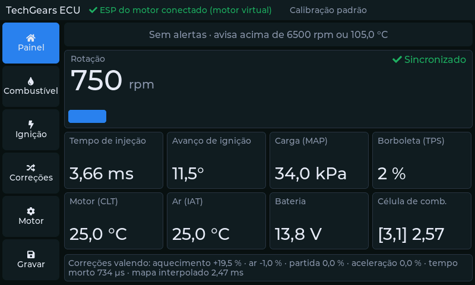
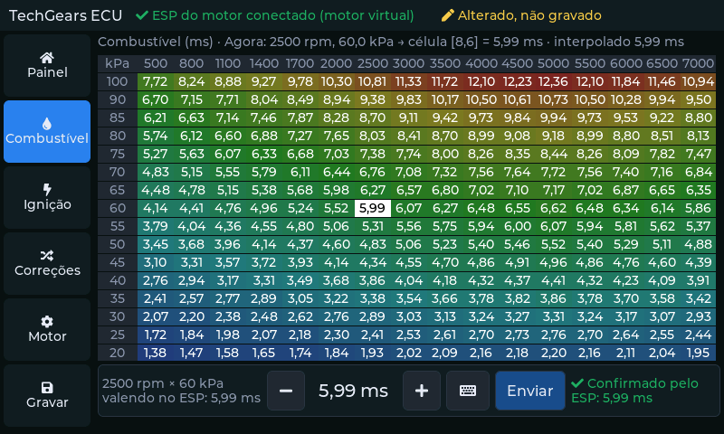
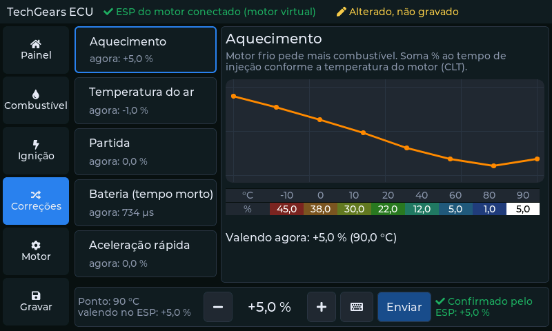

# HMI S3 da ECU: o que foi implementado

25 nov. 2026 · Celso (`celsick`)

> Cópia em Markdown do documento "HMI S3 da ECU: o que foi implementado" (claude.ai/artifact/VhvWhgWdSQTh7NpFyibkPp), exportada em 26 nov. 2026. As imagens apontam para as capturas de `docs/docs/img/hmi/`.

## Resumo

As 11 tasks da HMI S3 que estavam com o Celso (features 1.6 e 1.7) estão implementadas e testadas no computador, no [PR #193](https://github.com/TechGearsInteli/programmable-ecu/pull/193), com o Totti como revisor. Nada foi testado ainda em placa real.

| Task | Issue | O que entrega |
| --- | --- | --- |
| 1.6.1.1 | [#145](https://github.com/TechGearsInteli/programmable-ecu/issues/145) | Protocolo UART entre o ESP do motor e a tela |
| 1.6.1.2 | [#146](https://github.com/TechGearsInteli/programmable-ecu/issues/146) | Célula atual e valor do mapa na tela |
| 1.6.1.3 | [#147](https://github.com/TechGearsInteli/programmable-ecu/issues/147) | Edição de célula com limite e confirmação do ESP |
| 1.6.1.4 | [#148](https://github.com/TechGearsInteli/programmable-ecu/issues/148) | Grade 16×16 de combustível |
| 1.6.1.5 | [#149](https://github.com/TechGearsInteli/programmable-ecu/issues/149) | Grade 16×16 de ignição |
| 1.6.1.6 | [#184](https://github.com/TechGearsInteli/programmable-ecu/issues/184) | Correções 2D (aquecimento, ar, partida, bateria, aceleração) |
| 1.6.1.7 | [#185](https://github.com/TechGearsInteli/programmable-ecu/issues/185) | Ficha do motor |
| 1.6.1.8 | [#186](https://github.com/TechGearsInteli/programmable-ecu/issues/186) | Gravação na flash e backup em arquivo |
| 1.7.1.1 | [#187](https://github.com/TechGearsInteli/programmable-ecu/issues/187) | Simulador LVGL no PC |
| 1.7.1.2 | [#152](https://github.com/TechGearsInteli/programmable-ecu/issues/152) | Painel de instrumentos |
| 1.7.1.3 | [#153](https://github.com/TechGearsInteli/programmable-ecu/issues/153) | Alertas de RPM e temperatura |

O PR também traz dois firmwares (tela S3 e bancada do motor), o simulador e três páginas novas na documentação.

## Arquitetura

O ESP do motor guarda os mapas, confere limites e grava; a S3 só mostra e pede, como no [contexto das decisões](https://github.com/TechGearsInteli/programmable-ecu/blob/main/docs/docs/contexto-decisoes.md).

```text
ESP do motor (ESP32)                            ESP32-S3 + tela 4,3"
  núcleo src/firmware/common   <== UART ==>       telas src/firmware/hmi/ui
  (mapas, limites, flash)        3 fios           (mostra e pede)

No PC: motor virtual com o MESMO núcleo  <== fios em memória ==>  as MESMAS telas (hmi-sim)
```

| Pasta | O que tem |
| --- | --- |
| `src/firmware/common/` | Núcleo C99 (protocolo, mapas, PW, correções, ficha, gravação) e testes Unity |
| `src/firmware/hmi/ui/` | Telas LVGL 9.2.2, iguais no simulador e na S3 |
| `src/firmware/hmi/s3/` | Firmware da tela (PlatformIO, Sunton ESP32-8048S043C) |
| `src/firmware/motor-bench/` | Firmware de bancada do motor (potenciômetros, Serial, NVS) |
| `src/software/hmi-sim/` | Simulador no PC com motor virtual e cenários de teste |
| `tools/` | `host_build.py`, gerador de fontes com acento, conversor de capturas |

## Protocolo UART (#145)

Cada mensagem vai num frame com início, tamanho, número do pedido, tipo e CRC-16; a resposta é sempre o pedido + 0x80, e o ESP do motor responde com o valor que está valendo.

```text
A5 | LEN | SEQ | TYPE | PAYLOAD (0 a 240 bytes) | CRC16
```

| Pedido (tela → motor) | Resposta | Para quê |
| --- | --- | --- |
| 0x01 PING | 0x81 PONG | Achar o motor e conferir a versão |
| — | 0x10 TELEMETRIA (20 Hz, 44 bytes) | Painel, célula atual, correções valendo |
| 0x20 TABLE\_INFO | 0xA0 | Eixos, unidade e limites de uma tabela |
| 0x21 / 0x22 leitura | 0xA1 / 0xA2 | Uma célula / uma linha da grade |
| 0x23 CELL\_WRITE | 0xA3 | Escrever célula: OK ou FORA\_DO\_LIMITE |
| 0x30 / 0x31 ficha | 0xB0 / 0xB1 | Ler e escrever a ficha (só com motor parado) |
| 0x40 SAVE | 0xC0 | Gravar a RAM na flash |
| 0x50 a 0x53 backup | 0xD0 a 0xD3 | Exportar e importar em blocos de 200 bytes |

- **Autoridade:** a tela avisa se um valor vai ser recusado, mas quem decide é o motor; um valor recusado deixa o anterior valendo.
- **Erro de cabo:** CRC-16/CCITT-FALSE; frame com CRC errado é descartado e o parser se ressincroniza no próximo 0xA5 ou quando a linha fica 5 ms parada.
- **Reenvio:** um pedido por vez; sem resposta em 200 ms a tela reenvia (até 3 vezes) e o motor repete a resposta guardada em vez de aplicar duas vezes.

Detalhes e exemplos em bytes: `docs/docs/protocolo-uart.md`.

## Cálculo e calibração (#184, #185, #186)

O mapa guarda o tempo de injeção em ms (16 rotações × 16 cargas); com todas as correções em zero, o PW é exatamente a célula.

```latex
PW = c\acute{e}lula \times \frac{vaz\tilde{a}o_{ref}}{vaz\tilde{a}o_{bico}} \times (1+aquec)(1+ar)(1+partida)(1+acel) + t_{morto}(V_{bat})
```

- **Interpolação bilinear em inteiros:** o exemplo da Teoria do motor (2500 rpm, 60 kPa → 4,55 ms) virou teste e dá o mesmo número no ESP32, no PC e no Linux.
- **Correções 2D (#184):** 5 curvas de 8 pontos; 0 = sem correção; a partida só vale abaixo da rotação de partida; a aceleração segura 300 ms.
- **Ficha (#185):** cilindros (ordem de ignição, 720°/n), roda fônica, vazão do bico e de referência, dwell, rotação de partida e limites dos alertas; só muda com rpm = 0.
- **Gravação (#186):** blob `TGCL` de 1342 bytes com versão e CRC-32, gravado na NVS pela task da UART, nunca na interrupção do giro, e só com o motor parado. Ao ligar, blob inválido = mapa padrão.
- **Backup:** o mesmo blob vira arquivo; importar passa por versão, CRC e limites antes de valer na RAM.

O núcleo não agenda pulsos: ler a roda fônica e disparar bico e bobina continua com a feature 1.5.

## Telas

Seis telas em 800×480, as mesmas no simulador e na placa, com acentos via uma fonte gerada da Montserrat (as do LVGL só têm ASCII).

| Tela | O que mostra e faz | Tasks |
| --- | --- | --- |
| Painel | RPM com barra, PW, avanço, MAP, TPS, CLT, IAT, bateria, célula atual, correções valendo; atualiza a 10 Hz | #187, #152 |
| Alertas | Faixa vermelha e aviso na barra de cima quando RPM > 6500 ou CLT > 105 °C; não mexe no mapa | #153 |
| Combustível | Grade 16×16 com cores, célula atual em laranja, edição com −/+, teclado e Enviar | #146, #147, #148 |
| Ignição | Mesma grade, limite de −10 a 45° | #149 |
| Correções | 5 curvas com gráfico, ponto atual e valor valendo agora | #184 |
| Motor | Ficha com limites e ordem de ignição calculada | #185 |
| Gravar | Gravar na flash, exportar e importar backup, com estado da calibração | #186 |

As capturas abaixo saem dos cenários de teste do simulador.








## Testes e verificação

Tudo passa no computador: 37 testes do núcleo e 54 verificações de tela, sem falha nem aviso do compilador.

| O que | Resultado | Onde |
| --- | --- | --- |
| `test_protocol` | 10 testes passando | Linux (Docker) e Windows (zig) |
| `test_calib` | 8 testes passando | Linux e Windows |
| `test_engine` | 8 testes passando | Linux e Windows |
| `test_links` | 11 testes passando (tela e motor conversando) | Linux e Windows |
| `hmi_e2e` (cenários de tela) | 54 de 54 verificações | Linux (Docker) |
| Firmware S3 (`pio run`) | SUCCESS, RAM 9,3 %, flash 11,8 % | Windows |
| Firmware de bancada (`pio run`) | SUCCESS, RAM 9,8 %, flash 22,5 % | Windows |
| Docs (lint + Docusaurus) | 3 páginas no padrão, build sem erro | Windows |

Os cenários tocam nos mesmos botões que o usuário, conferem o texto da tela e o que mudou no motor virtual (por exemplo, 99,99 ms recusado e o mapa intacto).

## Como rodar

Com Python 3 e Docker Desktop aberto, um comando compila e testa tudo; em PCs com o Smart App Control ligado, que bloqueia executáveis recém-compilados, use `--docker`.

1. Preparar uma vez (≈ 5 min na primeira vez):

   ```bash
   git switch feat/1.6-1.7-hmi-s3
   python tools/host_build.py --docker
   ```
2. Testes do núcleo e cenários: `python tools/host_build.py --docker` → "100% tests passed".
3. Ver cada verificação de tela: `python tools/host_build.py --docker --cenarios` → linhas \[ok\] e "54 verificações, 0 falhas".
4. Gerar as imagens das telas: `python tools/host_build.py --docker --capturas build/demo`.
5. Compilar o firmware da S3: `cd src/firmware/hmi/s3` e `python -m platformio run` → \[SUCCESS\].
6. Janela interativa (só em PC sem Smart App Control): `python -m pip install --user cmake ninja ziglang` e `python tools/host_build.py --sim`.

## Pendências e próximos passos

Falta validar em placa real e combinar com a 1.5 como o firmware do motor usa o núcleo.

- [ ] Totti revisar o PR #193 (cards em Review)
- [ ] Definir e comprar a placa S3; conferir os pinos de `board.h` (hoje: Sunton ESP32-8048S043C, não validada)
- [ ] Bancada: tela e touch reais, fiação da UART, Serial do motor batendo com a tela
- [ ] Medir PW e avanço na lâmpada ou osciloscópio, junto com o firmware da 1.5
- [ ] Testar a NVS real e o reinício pela chave
- [ ] Combinar com o Lucas: o núcleo já cobre parte de #136, #137, #139, #140 e #142; o firmware do motor chama `ecu_engine_compute()` no laço e `ecu_motor_link_feed()` na task da UART

Fora deste PR: datalog e CSV (#154, #188) sem responsável, e a reescrita da arquitetura antiga (#191).
